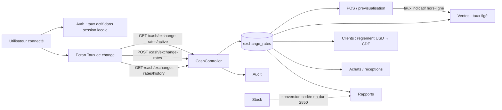

# Audit du module « Taux de change »

**Date :** 4 novembre 2026  
**Périmètre :** taux officiel USD → CDF (FIN-04 / RG-08), interface Angular, API NestJS, PostgreSQL/Prisma et flux avec Auth, POS/Ventes, Caisse, Clients, Achats/Fournisseurs, Stock et Rapports.  
**Méthode :** revue statique du code et des contrats OpenAPI ; compilation frontend et backend réussies. Aucune donnée réelle ni test E2E n'a été exécuté dans le cadre de cet audit.

## Conclusion exécutive

Le module existe et couvre son scénario nominal : saisie manuelle d'un taux USD/CDF, historique, droit métier `taux.modifier`, consultation API et figement du taux sur une vente. La base possède de bonnes contraintes de devise et de valeur positive.

Il n'est cependant **pas fiable pour une utilisation multi-officines ou pour une date d'effet choisie**. Les risques les plus urgents sont :

1. les endpoints de consultation utilisent une officine codée en dur au lieu de l'officine du JWT ;
2. la date d'effet affichée et envoyée par l'écran est ignorée par l'API ;
3. plusieurs chemins de calcul contournent le taux officiel avec `2850`, des taux futurs, ou le dernier taux sans borne temporelle ;
4. le droit permettant d'ouvrir l'écran n'est pas le droit exigé pour enregistrer le taux.

Ces écarts peuvent produire un mauvais taux affiché ou appliqué, bloquer un pharmacien autorisé à modifier le taux, et contaminer les calculs inter-officines.

## Architecture et flux actuel

### Interfaces exposées

| Opération | Contrat actuel | Constats |
|---|---|---|
| Lire le taux actif | `GET /api/v1/cash/exchange-rates/active?at=` | Le paramètre `at` est annoncé par le contrôleur mais n'est pas présent dans le fichier OpenAPI généré ; sans `at`, la recherche peut prendre un taux futur. |
| Créer un taux | `POST /api/v1/cash/exchange-rates` avec `rate`, `notes?` | Protégé par `taux.modifier`. `effectiveDate`, `baseCurrency` et `targetCurrency` envoyés par le frontend ne font pas partie du DTO/documentation. |
| Historique | `GET /api/v1/cash/exchange-rates/history` | Pas de filtre de période, de pagination ni de scoping JWT au contrôleur. |
| Taux dans connexion/profil | `POST /auth/login`, `GET /auth/me` | Le dernier taux est renvoyé au frontend et stocké dans `localStorage`; lui aussi n'est pas borné à maintenant. |

## Ce qui est bien réalisé

- La table `exchange_rates` stocke l'officine, le couple de devises, la valeur, le créateur, la date d'effet et une note ; la valeur est en `DECIMAL(12,4)`.
- Les contraintes SQL interdisent un taux négatif/nul, une devise hors CDF/USD et une paire identique ; l'unicité du quadruplet officine/devise/date est définie.
- La saisie côté serveur valide `rate >= 1`, impose le droit `taux.modifier` et écrit un audit de modification.
- L'écran Angular comporte un formulaire, une alerte d'absence, une vue d'historique, un état de chargement et une validation locale d'un taux positif.
- Les ventes enregistrent `exchange_rate_applied` et leurs montants CDF/USD. Les avoirs recalculent l'USD à partir du taux figé de la vente : c'est le bon principe d'historisation comptable.
- Les règlements client et les achats/réceptions recherchent un taux USD/CDF de l'officine avant conversion, avec erreur explicite s'il manque.
- Le POS demande le taux actif et le serveur recalcule le montant de prévisualisation : le navigateur n'est pas l'autorité finale pour une vente en ligne.

## Écarts, défauts et éléments manquants

| Priorité | Constat prouvé | Impact | Recommandation |
|---|---|---|---|
| **P0** | `getActiveRate()` et `getRatesHistory()` n'utilisent pas `req.user.pharmacyId`; le service leur applique l'identifiant par défaut `111...`. | Une autre officine peut lire l'historique/taux de l'officine pilote. | Passer systématiquement `req.user.pharmacyId`; supprimer toute valeur par défaut métier des méthodes publiques ; ajouter des tests avec deux officines. |
| **P0** | L'UI envoie `effectiveDate`, mais le DTO ne déclare que `rate` et `notes`; `setExchangeRate` ne renseigne pas `effective_date`. | La date saisie par l'utilisateur est silencieusement ignorée : l'historique et le taux applicable sont faux. | Ajouter `effectiveDate` au DTO, le valider (ISO-8601, fuseau), le persister et le refléter dans OpenAPI/client généré. |
| **P0** | `ensureInitialExchangeRate()` crée 2850 au démarrage ; la synchronisation offline utilise aussi 2850 si aucun taux n'existe ; le POS démarre à 2850 et recalcule avec ce repli. | Contradiction avec l'exigence « aucun taux par défaut » ; une opération peut être valorisée avec un taux fictif. | Retirer les replis de production. Réserver les données de démonstration aux seeds explicitement non production. Bloquer/mettre en conflit toute vente offline sans taux validé. |
| **P1** | Le menu et la route exigent `parametres.modifier`, alors que l'API exige `taux.modifier`. Le rôle PHARMACIEN reçoit `taux.modifier`, pas nécessairement `parametres.modifier`. | Un utilisateur autorisé côté API ne peut pas ouvrir l'écran. | Protéger route et entrée de menu avec `taux.modifier`; conserver `parametres.modifier` seulement pour les paramètres généraux. |
| **P1** | Les recherches « actives » de Caisse, Ventes et Auth prennent le dernier enregistrement sans `effective_date <= now`; certaines ne filtrent pas explicitement USD/CDF. | Un taux planifié dans le futur peut être appliqué aujourd'hui, ou une future paire de devises peut être choisie. | Centraliser `getRateAt(pharmacyId, instant, base, cible)` avec les filtres `USD/CDF`, `effective_date <= instant` et ordre déterministe. |
| **P1** | Le service Stock convertit la valorisation USD avec la constante 2850. | Les montants USD de stock divergent du taux officiel et des autres modules. | Injecter le résolveur de taux ou, mieux, renvoyer la valorisation CDF et préciser le taux/date de conversion utilisé pour la vue USD. |
| **P1** | Les rapports convertissent marge, stock, péremptions et créances avec un seul taux à la fin de période, et retournent `1` si le taux manque. | Les rapports historiques deviennent inexacts et l'absence de taux est masquée. | Conserver les montants historiques par devise ; lorsque la conversion est demandée, déclarer explicitement un taux de valorisation et échouer/avertir si absent. |
| **P1** | Le taux est figé sur `sales`, mais pas comme référence vers la ligne de taux ; achats/réceptions, règlements client, dépenses et sessions ne mémorisent pas tous le taux utilisé. | Audit difficile et incohérence possible lors des corrections ou recalculs historiques. | Ajouter `exchange_rate_id` et/ou `exchange_rate_applied` aux écritures monétaires qui convertissent effectivement ; ne jamais recalculer leur historique avec le taux courant. |
| **P2** | L'unicité porte sur un horodatage complet. Elle autorise plusieurs taux le même jour, tandis que l'interface marque simplement le premier historique comme « en vigueur ». | Statut visuel possiblement faux ; règle métier « taux quotidien » ambiguë. | Choisir et documenter la règle : un taux par journée locale, ou des taux intrajournaliers. Dans le premier cas, ajouter une clé de date locale ; dans le second, calculer le statut par rapport à l'instant courant. |
| **P2** | L'historique est renvoyé intégralement et ne fournit pas de filtre ni de pagination. | Performance/traçabilité dégradées à long terme. | Ajouter `from`, `to`, `page`, `limit`, tri et métadonnées ; offrir la consultation à une date donnée. |
| **P2** | L'audit est déclenché sans `await` après création du taux. | Une réponse réussie peut être renvoyée sans preuve d'audit si l'écriture échoue. | Décider si l'audit est obligatoire : s'il l'est, écrire taux et audit dans la même transaction; sinon le mettre dans une file fiable avec alerte. |
| **P2** | Les tests E2E sont superficiels pour ce domaine ; un test RG-08 poste en plus vers `/settings/exchange-rates`, route absente, sans vérifier le résultat de ce POST. | Le test peut « réussir » sans avoir réellement changé le taux. | Corriger la route dans le test et ajouter les scénarios de non-régression ci-dessous. |

## Cohérence avec les autres modules

| Module | État de l'intégration | Évaluation |
|---|---|---|
| Auth/layout | Le taux est chargé à la connexion/profil et affiché dans l'en-tête. | Fonctionnel, mais cache local possiblement périmé et recherche future non bornée. |
| POS/Ventes | Le POS lit le taux ; la prévisualisation et la vente le recalculent au backend ; la vente fige le taux. | Bonne direction, mais les defaults à 2850 et la recherche « dernier taux » affaiblissent RG-08. |
| Hors-ligne | Le POS transmet le taux indicatif hors-ligne ; le serveur compare le taux et audite l'écart. | Bonne intention, mais le fallback 2850 doit disparaître et la stratégie de conflit doit être spécifiée (acceptation, approbation ou rejet). |
| Caisse | Encaissements et dépenses sont suivis séparément en CDF/USD. | Cohérent par devise; les opérations de caisse ne doivent pas prétendre exiger un taux si elles n'effectuent aucune conversion. |
| Clients | Un règlement USD est converti au taux actif de l'officine. | Correct pour le présent, mais le taux appliqué devrait être figé avec le règlement. |
| Achats/Fournisseurs | Commandes et réceptions convertissent des prix CDF en USD via le taux courant. | Fonctionnel, mais la date/taux de conversion doit être archivé avec la commande/réception. |
| Stock | Les lots gardent prix CDF/USD. | Incohérent dans la valorisation, qui utilise 2850 en dur. |
| Rapports | Les revenus sont agrégés par devise ; certains KPI CDF sont convertis au taux en fin de période. | À corriger pour éviter une réévaluation historique non désirée et l'utilisation silencieuse de 1. |

## Plan de correction recommandé

### Lot 1 — Sécuriser la vérité métier (P0)

1. Créer un unique `ExchangeRateResolver` interne : `getRateAt(pharmacyId, instant, USD, CDF)`.
2. Faire passer l'officine issue du JWT dans les trois endpoints; interdire tout identifiant d'officine codé en dur hors fixtures de test.
3. Étendre `SetExchangeRateDto` avec `effectiveDate`; persister cette valeur; régénérer OpenAPI et le client Angular; supprimer le `as any` de l'écran.
4. Supprimer les taux de repli de runtime (Caisse, POS, synchronisation offline, Stock); retourner une erreur métier structurée lorsque le taux requis est absent.

### Lot 2 — Cohérence comptable et droits (P1)

1. Aligner les permissions de navigation sur `taux.modifier`.
2. Remplacer tous les accès directs à `exchange_rates` par le résolveur centralisé.
3. Ajouter le taux/identifiant de taux effectivement appliqué aux écritures converties et exposer cette trace dans les détails et exports.
4. Mettre à jour les rapports afin de privilégier les montants figés par devise; rendre explicite toute conversion de présentation.

### Lot 3 — Robustesse et exploitation (P2)

1. Formaliser la politique de taux intrajournalier, les fuseaux horaires (Africa/Kinshasa) et les droits de correction/annulation.
2. Rendre l'historique paginé/filtrable et ajouter des alertes de taux manquant ou ancien.
3. Rendre la création du taux et l'audit atomiques ou rendre l'échec d'audit observable.

## Tests indispensables avant mise en production

- Deux officines : chacune ne lit ni n'écrit le taux de l'autre.
- Date passée, présente et future : seul le dernier taux `<= instant` est obtenu.
- Date d'effet envoyée depuis l'écran : elle est strictement celle persistée et renvoyée.
- Aucun taux : vente, prévisualisation, règlement USD, achat/réception et synchronisation offline ont le comportement métier attendu sans valeur 2850/1 cachée.
- Vente puis changement de taux : facture, avoir et rapport de ventes conservent les montants/taux historiques.
- Règlement client, réception fournisseur et dépense : traçabilité du taux appliqué et conversion arrondie conforme.
- Autorisations : `taux.modifier` accède à l'écran et peut créer; les autres profils ne le peuvent pas.
- Contrat : OpenAPI, client généré et DTO Angular/Nest exposent les mêmes champs, notamment `effectiveDate`.

## Vérifications effectuées

- `npm.cmd run lint --workspace=@vhp/frontend` : réussi (`tsc --noEmit`).
- `npm.cmd run build --workspace=@vhp/backend` : réussi (`nest build`).

Ces vérifications confirment la compilabilité actuelle, pas la correction fonctionnelle des flux ci-dessus. Les fichiers déjà modifiés dans l'espace de travail ont été préservés; ce rapport est ajouté séparément.

## État d'exécution du plan (mise à jour)

### Livré dans cette itération

- Résolveur backend central `ExchangeRateResolver.getRateAt(...)` avec filtre officine, paire USD/CDF, date `<= instant` et erreur `EXCHANGE_RATE_MISSING`.
- Endpoints actif/historique/écriture scoppés par `req.user.pharmacyId` ; suppression des identifiants d'officine de secours dans ces chemins.
- `effectiveDate` ajouté au DTO, validé en ISO, persisté et exposé dans OpenAPI/client Angular ; le `as any` de l'écran a été supprimé.
- Accès ventes, achats, clients, rapports et valorisation stock branchés sur le résolveur ou sur la même règle temporelle ; le fallback de valorisation stock `2850` a été supprimé côté backend.
- Navigation frontend alignée sur `taux.modifier`.
- `sales.exchange_rate_id` ajouté (nullable pour compatibilité avec les ventes existantes) et renseigné lors d'une vente en ligne ou d'un conflit offline.
- Tests E2E de saisie mis à jour pour fournir `effectiveDate` et utiliser `/cash/exchange-rates`.

### Reste à faire avant clôture complète

- Migrer les conversions d'aperçu frontend fournisseurs/réceptions qui affichent encore `2850` ; elles ne sont pas l'autorité de persistance mais peuvent induire l'utilisateur en erreur.
- Ajouter les références de taux aux règlements clients et aux écritures achats/réceptions, puis exposer ces références dans les détails/exports.
- Remplacer le code d'initialisation démonstration encore présent dans le fichier CashService par un mécanisme de seed explicitement hors production.
- Ajouter et exécuter les tests d'isolation entre officines, de dates passée/future, d'absence de taux et de conservation historique listés plus haut.
