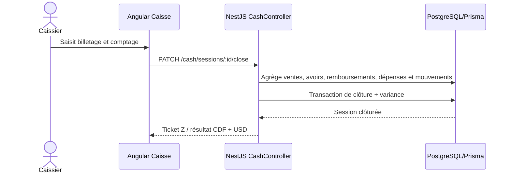

# Module Caisse & Finances

## Flux de clôture

## Mouvements de caisse

`cash_movements` conserve chaque `APPORT` ou `RETRAIT` avec sa session, son auteur, le motif et le taux de change historisé. L’écriture et la mise à jour de `expected_amount_cdf` / `expected_amount_usd` sont effectuées dans une transaction Prisma.

Endpoints :

- `POST /api/v1/cash/sessions/:id/movements` — permission `finances.mouvement`.
- `GET /api/v1/cash/sessions/:id/movements` — permission `finances.consulter`.
- `GET /api/v1/reports/treasury` — soldes avec colonnes `credit` et `debit`, exportables en CSV/XLS/PDF.

La spécification OpenAPI générée est disponible dans `apps/frontend/openapi.json`.
